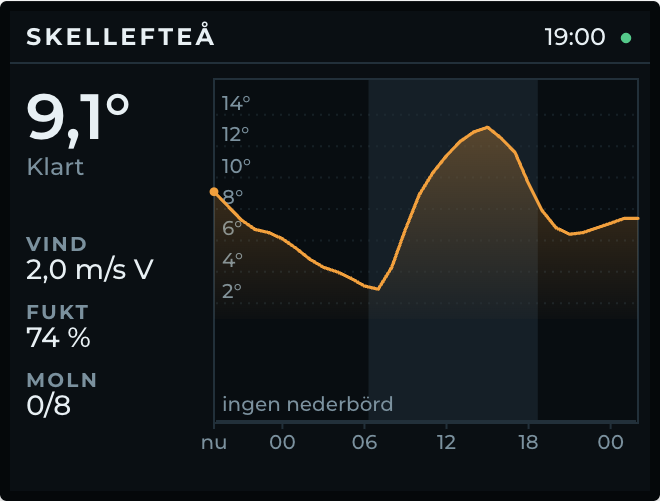
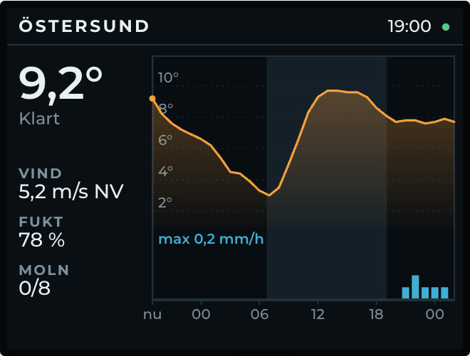
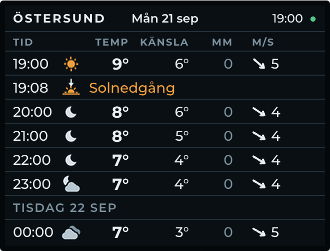

# SMHI weather panel for the Freenove ESP32 Display

[](https://github.com/hniska/smhi-esp32-display/actions/workflows/ci.yml)
[](LICENSE)


A 320 × 240 weather panel for the Freenove ESP32 Display (FNK0103). It shows
the [SMHI](https://www.smhi.se) forecast for one location as a meteogram:
a temperature curve, precipitation bars and night bands for the next 31 hours.
Touch the screen to see an hour-by-hour table.

<p align="center">
  
  
  
</p>

<sub>The images come from the pixel-exact design preview with real SMHI data
(see [Design preview](#design-preview)). The user interface is in Swedish.</sub>

## Features

- **Meteogram.** Temperature curve, precipitation bars and night bands for 31
  hours. The left column shows the current temperature, weather, wind,
  humidity and cloud cover.
- **Hour table.** Touch the screen to see two pages of eight hours each:
  time, weather icon, temperature, feels-like temperature, precipitation and
  wind with a direction arrow. The table also shows sunrise, sunset and a
  header row at midnight. The panel goes back to the meteogram after two
  minutes.
- **Calculated night bands.** The panel calculates sunrise and sunset on the
  device (NOAA algorithm). At 64.75° N the day length changes from 3 h 45 min
  to 21 h 45 min during the year, so the night bands give real information.
- **Feels-like temperature.** SMHI does not supply this value. The panel
  calculates the wind chill (JAG/TI formula) when the temperature is 10 °C or
  less and the wind is 1 m/s or more.
- **Freshness indicator.** The dot in the top-right corner is green when the
  data is new. It becomes orange when the data is older than two refresh
  intervals (one hour with the default settings).
- **Swedish characters.** Custom Montserrat fonts with å, ä, ö and °.
- **Automatic daylight saving time.** NTP and the Swedish time zone rule.
- **Host tests.** The forecast logic runs and is tested on your computer.
- **Screenshots over USB.** Get the exact pixels from the panel as a PNG file.

## Hardware

| Part | Notes |
|---|---|
| Freenove ESP32 Display (FNK0103), 2.4" or 2.8", 240 × 320 | ST7789 or ILI9341 driver. The panel runs in landscape mode. |
| USB cable | The board has a CH340 USB-to-serial chip. |

The 3.5" and 4.0" variants (ST7796, 320 × 480) are not supported. They need a
new layout in `SMHI_Display/theme.h` and `tools/build_preview.py`.

## Quick start

You need [PlatformIO](https://platformio.org). The commands below use
[uv](https://docs.astral.sh/uv/) to install it.

```bash
uv tool install platformio

git clone https://github.com/hniska/smhi-esp32-display.git
cd smhi-esp32-display

cp SMHI_Display/config.example.h SMHI_Display/config.h
$EDITOR SMHI_Display/config.h        # Wi-Fi name, password and location

pio run -t upload                    # build and flash (ST7789 panel)
pio device monitor                   # serial log, 115200 baud
```

For an ILI9341 panel, use `pio run -e fnk0103_2p8_ili9341 -t upload`.

The fonts and icons are already in the repository. You do not need to make
them again.

On start, the serial log shows the Wi-Fi connection and the first forecast:

```
[wifi] ssid=... rssi=-19 ip=... gw=... mask=... dns=...
[wifi] slår upp smhi-mcp.hakan-3a6.workers.dev: ...
[smhi] ok (32 perioder)
```

The panel shows data approximately four seconds after reset.

## Configuration

All settings are in `SMHI_Display/config.h`. Git ignores this file, because it
contains your Wi-Fi password. Copy it from `config.example.h`.

| Setting | Default | Description |
|---|---|---|
| `WIFI_SSID`, `WIFI_PASSWORD` | — | Your Wi-Fi network. |
| `LOC_NAME_SV`, `LOC_NAME` | Skellefteå | The location name in the header. `LOC_NAME` is the ASCII fallback. |
| `LOC_LAT`, `LOC_LON` | 64.75, 20.95 | The location. SMHI uses the nearest grid point (approximately 2.8 km). |
| `REFRESH_MS` | 30 min | Time between two forecast downloads. |
| `RETRY_MS` | 1 min | Time before a new attempt after a failed download. |
| `TZ_SWEDEN` | CET/CEST | POSIX time zone rule. |
| `PANEL_ROTATION` | 1 | Set to 3 if the image is upside down in your enclosure. |
| `DETAIL_TIMEOUT_MS` | 2 min | Time before the hour table goes back to the meteogram. 0 = never. |
| `MCP_HOST` | `smhi-mcp.hakan-3a6.workers.dev` | The forecast server. See [Data source](#data-source). |

## How to use

| Action | Result |
|---|---|
| Touch the screen | Meteogram → hours, page 1 → hours, page 2 → meteogram. |
| No touch for 2 minutes | The panel goes back to the meteogram. |

You can touch the screen at any position. The panel does not need touch
calibration.

## Data source

The panel gets the forecast from SMHI open data (`snow1g` v1) through an MCP
server on Cloudflare Workers:
[hniska/smhi-mcp](https://github.com/hniska/smhi-mcp). The panel sends
MCP JSON-RPC requests with HTTP POST.

Why the panel does not use the SMHI API directly:

| | Size | Periods |
|---|---|---|
| SMHI `snow1g` v1, raw | 66 kB | 81 (10 days) |
| MCP server, `limit=32` | 9.7 kB | 32 (31 hours) |

The MCP response is seven times smaller and has flat fields. On an ESP32, this
is the difference between a streaming parser with low free heap and a simple
`JsonDocument` with a good margin.

The default server is a public instance that the author operates. It has no
uptime guarantee. For a permanent installation, deploy your own instance of
[smhi-mcp](https://github.com/hniska/smhi-mcp) and set `MCP_HOST` in
`config.h`.

> [!NOTE]
> SMHI closed the old `pmp3g` API on 2026-03-31. All requests to
> `category/pmp3g/version/2` now return 404. The MCP server uses `snow1g` v1
> and keeps the old field names, so this panel did not need a change.

SMHI data is free to use under [CC BY 4.0](https://www.smhi.se/data/oppna-data).

## Development

### Host tests

```bash
pio test -e native
```

The hour-table logic (`sun.cpp`, `detail.cpp`, `forecast.h`) has no Arduino
or LVGL dependencies. The tests in `test/test_detail/` run on your computer in
less than one second. They check:

- the feels-like temperature against the SMHI app for Skellefteå
- sunrise and sunset times against known times (the clock times, not only the
  day length — a wrong longitude sign gives the correct day length)
- that each weather symbol 1–27 has an icon, and night icons only where the sun
  is down
- the order of the table rows, the sunset row and the midnight header

### Design preview

Open `design/preview.html` in a browser. It shows the panel pixel-exact, with
real SMHI data for a dry location (Skellefteå) and a wet location (Östersund).

```bash
python3 tools/build_preview.py        # build the preview from the saved data
./tools/fetch_samples.sh              # get new data, then build the preview
./tools/render_readme_images.py       # make the images in docs/images/
```

The preview and the firmware use the same geometry, colours and fonts. There
is one intentional difference: the preview fills the area below the
temperature curve with a gradient. LVGL 8 cannot fill a path, so the panel
uses a flat, low-opacity fill per column.

### Screenshots over USB

The firmware can send the screen contents over the serial port:

```bash
./tools/screenshot.py -p /dev/cu.usbserial-110 -o panel.png
./tools/screenshot.py -p /dev/ttyUSB0 --page 1 -o hours.png
```

Close `pio device monitor` first. A full screen takes approximately 18 seconds
at 115200 baud. Refer to [docs/development.md](docs/development.md) for more
information and the other serial console commands.

### More documentation

- [docs/development.md](docs/development.md): serial console, screenshots,
  palette, memory use and the Arduino IDE build.
- [docs/pitfalls.md](docs/pitfalls.md): problems that we found during
  development, and their causes. Read this before you change the fonts, the
  display buffer, the touch code or the JSON client.

## Project layout

```
platformio.ini         build configuration, pins for both panel variants, host tests
include/lv_conf.h      LVGL configuration
lib/TFT_Touch/         Freenove TFT_Touch v0.3 (XPT2046 touch controller)
test/test_detail/      host tests (pio test -e native)
SMHI_Display/
  SMHI_Display.ino     Wi-Fi, NTP, touch, refresh loop
  config.example.h     configuration template
  smhi_client.*        MCP client with two-stage JSON decoding
  ui.*                 LVGL user interface: meteogram and hour table
  theme.h              palette and geometry (the same as build_preview.py)
  forecast.h           forecast data types, no Arduino dependencies
  sun.*                sunrise and sunset (NOAA)
  detail.*             hour-table logic: feels-like, icons, rows
  console.*            serial console: screenshots, font test, colour bars
  fonts/, icons/       generated files
design/                design preview and sample data
tools/                 font, icon, preview and screenshot tools
docs/                  documentation and README images
```

## Licence

- Source code and documentation: [MIT](LICENSE).
- `lib/TFT_Touch/`: TFT_Touch v0.3 by Bodmer
  (<https://github.com/Bodmer/TFT_Touch>), with the terms from
  HobbyComponents.com in `TFT_Touch.h`.
- `SMHI_Display/fonts/`: converted from Montserrat, SIL Open Font License 1.1.
- `include/lv_conf.h`: LVGL configuration file, MIT licence.
- Forecast data: SMHI, CC BY 4.0.

## Acknowledgements

- [SMHI](https://www.smhi.se) for the open forecast data.
- [Freenove](https://github.com/Freenove/Freenove_ESP32_Display) for the
  hardware, pin setups and libraries.
- [LVGL](https://lvgl.io), [TFT_eSPI](https://github.com/Bodmer/TFT_eSPI) and
  [ArduinoJson](https://arduinojson.org).
